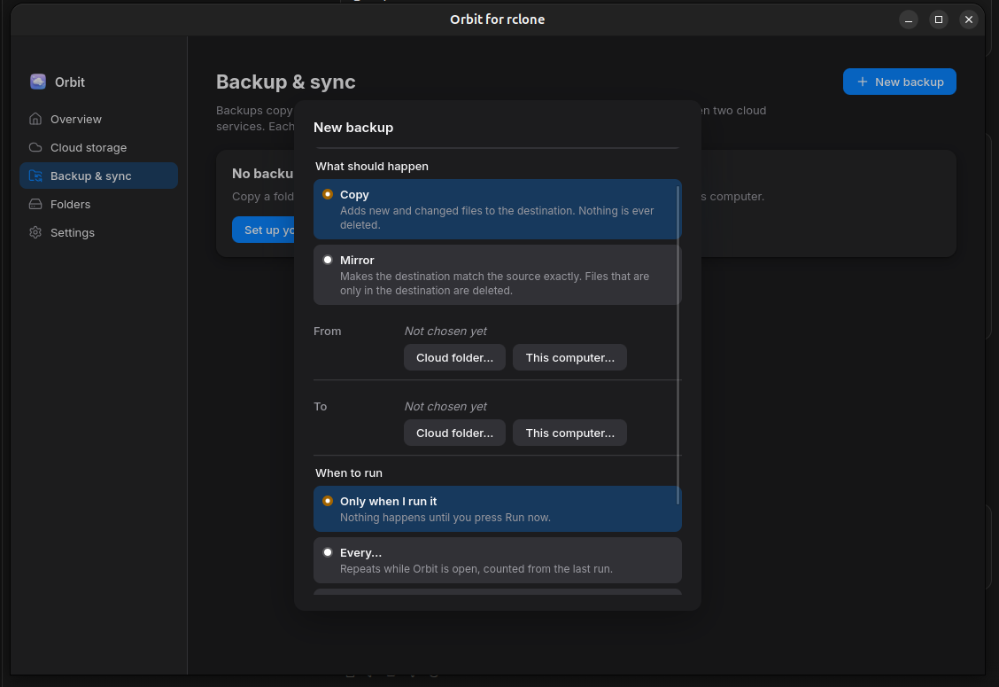
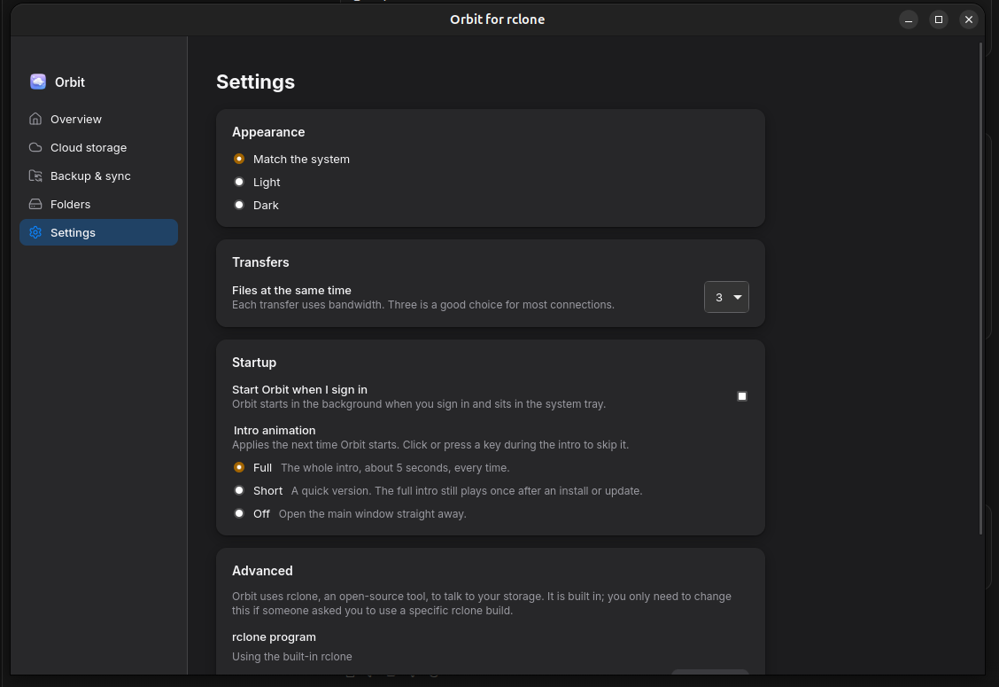
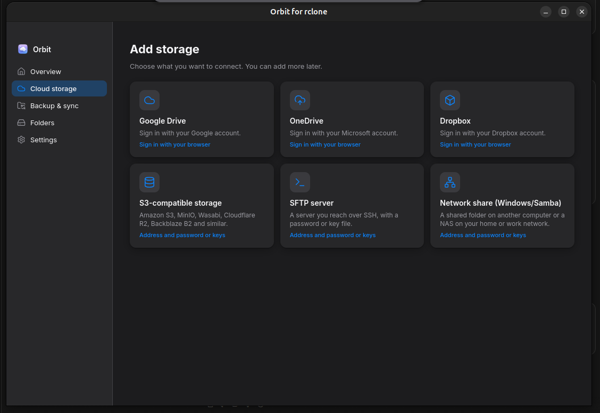

# Orbit for rclone

A desktop app for [rclone](https://rclone.org). Connect cloud storage, browse and move files, run sync and copy jobs, and mount remotes as folders or drives, without installing or configuring rclone yourself.

Orbit ships its own rclone and runs it as a background daemon (`rclone rcd`) on the loopback interface. The app talks to it through rclone's JSON remote-control API.

- **Platforms:** Linux (AppImage, `.deb`, snap) and Windows (`.msi`).
- **Stack:** Tauri 2 (Rust), SvelteKit in SPA mode, TypeScript.
- **Design:** see [SPEC.md](SPEC.md). Contributor rules are in [CLAUDE.md](CLAUDE.md).
- **Changes:** see [CHANGELOG.md](CHANGELOG.md). Licence: [Apache-2.0](LICENSE).

## Screenshots

| Cloud storage | Backup & sync | Settings |
|---|---|---|
|  |  |  |

## Install

Download the file for your system from the [latest release](https://github.com/quietbytehq/orbit/releases/latest).
The releases are not code-signed yet, so both Windows and some Linux desktops will ask you to confirm.

### Linux: AppImage

```bash
chmod +x orbit_1.0.1_amd64.AppImage
./orbit_1.0.1_amd64.AppImage
```

Needs a 64-bit x86 system with WebKitGTK 4.1 (Ubuntu 22.04 or newer, Fedora 37 or newer, and
similar). AppImages mount themselves with FUSE 2; if your system has only FUSE 3 and the file
refuses to start, run it with `--appimage-extract-and-run`. To show cloud storage as a folder,
install FUSE 3 (`sudo apt install fuse3` on Debian and Ubuntu); Orbit tells you if it is missing.

### Linux: Debian and Ubuntu package

```bash
sudo apt install ./orbit_1.0.1_amd64.deb
```

This pulls in WebKitGTK and the tray library. Orbit then appears in your application menu as
"Orbit for rclone". Install `fuse3` as above to use folders.

### Linux: snap

```bash
sudo snap install orbit-rclone                                  # from the Snap Store
sudo snap install --dangerous ./orbit-rclone_1.0.1_amd64.snap   # or from a release file
sudo snap connect orbit-rclone:fuse-support                     # needed for Drives, see below
```

The snap is strictly confined. It can reach the network, your home folder and removable media,
and shows its tray icon through the desktop interfaces. **Showing storage as a folder needs
`fuse-support`**, which the store does not connect automatically yet, so run the `snap connect`
line above once; without it the Folders page says FUSE is unavailable. Everything else works
without it. Inside the snap, "Start Orbit when I sign in" uses the snap's own autostart entry.
The snap is called `orbit-rclone` (the name `orbit` was taken on the store); the app still shows
up as "Orbit for rclone", and `orbit-rclone` on a command line launches it.

### Windows: installer

Run `orbit_1.0.1_x64_en-US.msi`. Windows 10 or 11, 64-bit; WebView2 is already present on current
systems. Because the installer is not signed, SmartScreen may show "Windows protected your PC":
click **More info**, then **Run anyway**. Orbit installs per machine and adds a Start menu entry.

**Drives need WinFsp.** To show cloud storage as a drive letter in File Explorer, install
[WinFsp](https://winfsp.dev/rel/) (free, one minute). Orbit does not bundle it; the Drives page
prompts for it with a download button and a "Check again" button once it is installed. Everything
else (browsing, transfers, backups) works without it.

### Updating

Install the new file over the old one. Settings, backups, remembered drives and the rclone config
stay in the app data folder (see *Where your data lives*).

## What works (v0.2)

| Area | Status |
|---|---|
| rclone lifecycle: start, health check, restart with backoff, clean stop, no orphan on crash | Done, tested with a real rclone |
| Tray with synced, syncing and disconnected icons; white or dark set by system theme | Done (Linux run; Windows icons compile-checked only) |
| Splash: full intro (about 5.5 s) on first launch and after an update, short (1.5 s) otherwise, or off; skippable; reduced-motion aware | Done; timings tested, not reviewed by eye |
| Plain-language UI with Windows or Linux wording, lucide icons, error details behind "Show details" | Done; checked in screenshots of the built UI with fake data |
| Remote wizards: Google Drive, OneDrive, Dropbox (browser sign-in), S3-compatible, SFTP, network shares (SMB) | Done. Browser sign-in is tested up to the callback only, see below. SMB is tested for parameter handling and failure messages, not against a live server |
| Connection test, edit, rename, delete, status badges (up to date, syncing, disconnected) | Done |
| File browser: list, folders, multi-select, new folder, rename, delete | Done, tested with rclone's `alias` backend |
| Upload (picker or drag and drop), download, copy and move between remotes | Done, tested |
| Transfer queue with progress, speed, ETA and cancel; concurrency from settings | Done, tested |
| Sync and copy jobs with run history (last 20 runs), logs, error counts | Done, tested |
| Scheduled jobs: every N minutes or hours, or daily at a time, while Orbit is open | Done, tested against a real rclone |
| Mount and unmount (Linux via FUSE 3; Windows via WinFsp with a drive letter) | Done on Linux, tested with a real FUSE mount. Windows not run |
| Settings: theme, concurrent transfers, custom rclone path, log level, intro animation, start at sign-in | Done; start at sign-in not run on a real desktop |
| Remembered drives and folders, reconnected automatically at startup | Done; store tested, reconnection not run on a real desktop |
| Packaging: AppImage and `.deb`, named `orbit_<version>_…` | Built in CI on every push |
| Packaging: `.msi`, named `orbit_<version>_…` | Built in CI on Windows on every push; not installed on a real machine |

Out of scope for v0.2 (see SPEC §9): cron-style schedules and missed-run catch-up, bisync, conflict handling, the advanced remote editor, auto-update, macOS.

## Not verified yet

Please read this before relying on v0.2:

- **Real cloud accounts.** Google Drive, OneDrive and Dropbox sign-in was not completed against live accounts, since none were available. The flow was tested up to rclone's local callback: a bogus code makes rclone report the failure, the call returns, and no stub remote is left behind. S3 and SFTP were tested for their parameter handling and their failure messages, not against live servers.
- **Windows at runtime.** The Rust tests (including the integration tests against a real rclone, the kill-on-close job object and the no-console spawn path) run on Windows in CI and pass, and the `.msi` builds there. The app itself has not been launched on a Windows desktop: the tray, windows, WinFsp mounting, start-at-sign-in and the installer are unverified by eye.
- **Look and feel.** Pages were reviewed from screenshots of the built UI rendered in Chromium with fake data, not in the real Tauri window.
- **GNOME tray.** On GNOME, tray icons need the AppIndicator extension. Without it, the tray icon will not appear, though the app still works.

## Build from source

### Prerequisites

Linux (Debian or Ubuntu):

```bash
sudo apt install build-essential pkg-config curl unzip \
  libwebkit2gtk-4.1-dev libjavascriptcoregtk-4.1-dev libsoup-3.0-dev \
  libgtk-3-dev librsvg2-dev libayatana-appindicator3-dev \
  fuse3   # for mounting remotes
```

Then install [Rust](https://rustup.rs) (stable) and Node.js 22 or newer.

Windows:

- Rust with the MSVC toolchain, Node.js 22 or newer, and PowerShell.
- WebView2 (already installed on current Windows 10 and 11).
- [WinFsp](https://winfsp.dev) to mount remotes. Orbit prompts for it and does not bundle it.

### Steps

```bash
npm install
scripts/fetch-rclone.sh            # Windows: scripts\fetch-rclone.ps1
npm run tauri dev                  # run the app
```

The fetch script downloads the rclone version pinned in `scripts/rclone-version.txt` from `downloads.rclone.org`. It checks the archive against the published SHA256SUMS before installing it into `src-tauri/binaries/`. Those binaries are not committed.

### Tests

```bash
cargo test --manifest-path src-tauri/Cargo.toml   # unit and integration tests
npm run check                                     # svelte-check, strict TypeScript
npm test                                          # vitest
```

Integration tests run a real `rclone rcd`. They use the sidecar in `src-tauri/binaries/`, or an rclone on `PATH`, or the path in `ORBIT_TEST_RCLONE`. They skip with a message when none is found. Mount tests skip when FUSE is missing.

### Packaging

```bash
npm run bundle:linux     # fetch rclone, then AppImage and .deb
npm run bundle:windows   # fetch rclone for Windows, then .msi (run on Windows)
```

Outputs go to `src-tauri/target/release/bundle/`, named `orbit_<version>_…` (the scripts rename Tauri's "Orbit for rclone_…" files; the display name is unchanged).

### Regenerating icons

- App icon: `npx tauri icon assets/orbit-icon.png` writes into `src-tauri/icons/`.
- Tray icons: `assets/tray-icons-v2/gen.py` makes all sizes and the `.ico` files. It needs `cairosvg`, `numpy` and `Pillow`. Run it from inside `assets/tray-icons-v2/`.

## Where things live

| Path | Purpose |
|---|---|
| `src-tauri/src/rclone/` | Process supervision, RC client |
| `src-tauri/src/remotes/` | Provider wizards, rclone config operations, sign-in |
| `src-tauri/src/files/` | Browsing, transfer queue |
| `src-tauri/src/jobs/` | Sync and copy jobs, run history |
| `src-tauri/src/mounts.rs` | Mounting, FUSE and WinFsp checks |
| `src-tauri/tests/` | Integration tests against real rclone |
| `src/routes/` | Screens (splash, overview, remotes, browse, sync, mounts, settings) |
| `src/lib/` | Typed API layer, stores, components, helpers |

## Where your data lives

Everything is under the Tauri app data folder: `~/.local/share/com.orbit.rclone` on Linux and `%APPDATA%\com.orbit.rclone` on Windows.

- `rclone.conf` is rclone's own config. **It is the only place credentials are stored.** Orbit does not keep its own copy.
- `settings.json`, `jobs.json` and `mounts.json` hold preferences, backup definitions and remembered drives, with no secrets.
- `logs/` holds the rclone log and one log per job run.

## Known limitations

- Drives and folders end when Orbit quits. Ones marked "connect automatically" come back once Orbit is running and its engine is up.
- Scheduled jobs run only while Orbit is open. A run that was due while Orbit was closed is not made up, and nothing runs on login.
- Deletes are permanent. Orbit does not use a provider's trash.
- A job's error list shows each new error as it appears, not every error from the run.
- Browser sign-in uses rclone's shared OAuth client IDs, so providers may rate-limit heavy use.
- The rclone that ships with Orbit is what it runs by default. If you choose a custom rclone, a snap-packaged build may not be able to write to the app data folder.
- The WinFsp installer is not bundled. See SPEC §6.

## Releases

Every push runs CI (tests and a launch-and-quit smoke test on Linux, bundles on Linux and Windows,
the snap). Pushing a tag `v*` additionally creates a GitHub Release with the AppImage, `.deb`,
`.snap` and `.msi` attached, once the test jobs are green.

## Licence and third-party

Orbit is released under the [Apache License 2.0](LICENSE), copyright 2026 QuietByte. See
[NOTICE](NOTICE) for the bundled third-party software.

- [rclone](https://rclone.org), MIT licence, bundled unmodified as a separate sidecar binary and
  run as a background process. Orbit is not affiliated with the rclone project.
- [Inter](https://rsms.me/inter/) typeface, SIL Open Font License 1.1, bundled in `static/fonts/` with its licence file.

## Roadmap

See SPEC §9.
